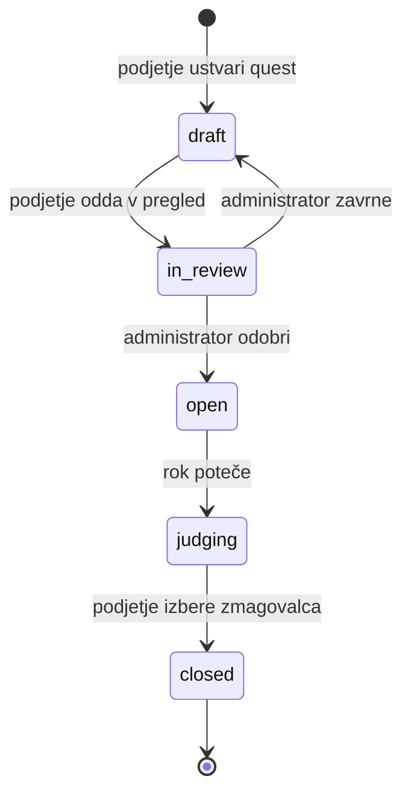

## ------- Funkcionalnosti in obseg -------

### Uporabniške vloge

#### 1. Podjetje

**Lahko:**

- ustvari in ureja profil podjetja,
- objavi quest z opisom, referenčnimi slikami, nagrado in rokom,
- ureja quest, dokler ga administrator ne odobri,
- pregleduje odobrene oddaje na svojih questih,
- po izteku roka izbere zmagovalca.

**Ne more:**

- oddajati videov,
- odobravati questov ali moderirati oddaj,
- urejati ali brisati oddaj ustvarjalcev,
- izbrati zmagovalca pred iztekom roka.

#### 2. Ustvarjalec

**Lahko:**

- brska po odprtih questih in prenese referenčno gradivo,
- do roka odda video na odprt quest,
- pred rokom uredi ali umakne svojo oddajo,
- spremlja status svojih oddaj,
- ima javni profil z zmagami in oddajami.

**Ne more:**

- objavljati questov,
- videti oddaj drugih ustvarjalcev, dokler quest ni zaključen,
- oddati videa po izteku roka,
- vplivati na izbor zmagovalca.

#### 3. Administrator

**Lahko:**

- odobri ali zavrne nov quest,
- odobri ali zavrne oddaje (video) z navedbo razloga,
- blokira uporabnike, ki kršijo pravila.

**Ne more:**

- izbrati zmagovalca (to je odločitev podjetja),
- objavljati questov ali oddajati videov v imenu drugih.

### Predvidene funkcionalnosti

| # | Funkcionalnost | MVP |
|---|---|---|
| 1 | Registracija in prijava z izbiro vloge (podjetje ali ustvarjalec) | MVP |
| 2 | Objava questa z zahtevami: opis, referenčne slike, nagrada, rok | MVP |
| 3 | Odobritev ali zavrnitev questa s strani administratorja | MVP |
| 4 | Pridružitev in oddaja izdelka z opisom in navedbo uporabljenega orodja | MVP |
| 5 | Moderacija oddaj z razlogom zavrnitve | MVP |
| 6 | Samodejno zaprtje questa ob izteku roka | MVP |
| 7 | Izbor in razglasitev zmagovalca | MVP |
| 8 | Brskanje po odprtih questih s filtri in razvrščanjem | |
| 9 | Skrite oddaje do zaključka questa, da ustvarjalci ne kopirajo idej | |
| 10 | Javna galerija zaključenih questov in zmagovalnih videov | |
| 11 | Profil ustvarjalca s seznamom oddaj in zmag | |
| 12 | Lestvica ustvarjalcev glede na zmage | |
| 13 | Kratka povratna informacija podjetja na posamezno oddajo | |
| 14 | Obvestila v aplikaciji ob spremembi statusa (odobritev, zmaga) | |

## Kasnejše nadgradnje

- shranjevanje videov in slik v oblak (Supabase Storage) namesto v lokalno mapo,
- objava celotne aplikacije v oblaku (AWS Amplify) in prenos baze v Supabase,
- e-poštna obvestila,
- statistika questa za podjetje (število oddaj, ogledov),
- samodejno preverjanje formata videa (dolžina, razmerje slike),
- samodejno zaznavanje neprimerne vsebine z AI,
- sporočila med podjetjem in ustvarjalcem.

## Izven obsega

- izplačilo nagrad prek plačilnega sistema (npr. Stripe),
- generiranje in urejanje AI videov znotraj platforme,
- mobilna aplikacija,
- pravno urejanje avtorskih pravic vsebine.

### Delovni proces questa (netrivialen delovni proces)

Quest stanja:

1. **Osnutek** – podjetje pripravlja quest.
2. **V pregledu** – čaka na odobritev administratorja.
3. **Odprt** – ustvarjalci lahko oddajajo videe.
4. **V presoji** – rok je potekel, podjetje izbira zmagovalca.
5. **Zaključen** – zmagovalec je razglašen.

