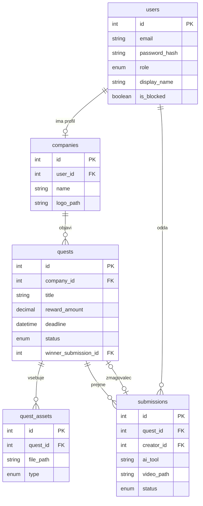

## ------- Podatkovni model -------

### Entitete

#### 1. users

Vsi uporabniki sistema, vloga določa pravice.

| Polje | Tip | Opis |
|---|---|---|
| id | Int, PK | |
| email | String, unikaten | prijavno ime |
| password_hash | String | zakodirano geslo |
| role | enum | `company`, `creator`, `admin` |
| display_name | String | prikazno ime |
| is_blocked | Boolean | blokiran uporabnik se ne more prijaviti |
| created_at | DateTime | |

#### 2. companies

Profil podjetja, obstaja samo za uporabnike z vlogo `company`.

| Polje | Tip | Opis |
|---|---|---|
| id | Int, PK | |
| user_id | Int, FK → users, unikaten | lastnik profila |
| name | String | ime podjetja |
| website | String | spletna stran |
| logo_path | String | pot do logotipa |
| description | String | kratek opis |

#### 3. quests

Natečaj, ki ga objavi podjetje.

| Polje | Tip | Opis |
|---|---|---|
| id | Int, PK | |
| company_id | Int, FK → companies | |
| title | String | naslov |
| description | String | opis želenega videa |
| requirements | String | dolžina, razmerje slike, ostale zahteve |
| reward_amount | Decimal | višina nagrade v EUR |
| deadline | DateTime | rok oddaje |
| status | enum | `draft`, `in_review`, `open`, `judging`, `closed` |
| rejection_reason | String, NULL | razlog zavrnitve s strani administratorja |
| winner_submission_id | Int, FK → submissions, NULL | zmagovalna oddaja |
| created_at | DateTime | |

#### 4. quest_assets

Referenčno gradivo, ki ga podjetje priloži questu.

| Polje | Tip | Opis |
|---|---|---|
| id | Int, PK | |
| quest_id | Int, FK → quests | |
| file_path | String | pot do datoteke |
| type | enum | `image`, `logo`, `other` |
| original_name | String | izvirno ime datoteke |

#### 5. submissions

Video, ki ga ustvarjalec odda na quest.

| Polje | Tip | Opis |
|---|---|---|
| id | Int, PK | |
| quest_id | Int, FK → quests | |
| creator_id | Int, FK → users | |
| title | String | naslov oddaje |
| description | String | kratek opis ideje |
| ai_tool | String | uporabljeno orodje (npr. Runway, Sora) |
| video_path | String | pot do videa |
| status | enum | `pending`, `approved`, `rejected`, `withdrawn` |
| rejection_reason | String, NULL | razlog zavrnitve |
| created_at | DateTime | |

### Diagram

Diagram prikazuje glavna polja, vsa polja so v tabelah zgoraj.

