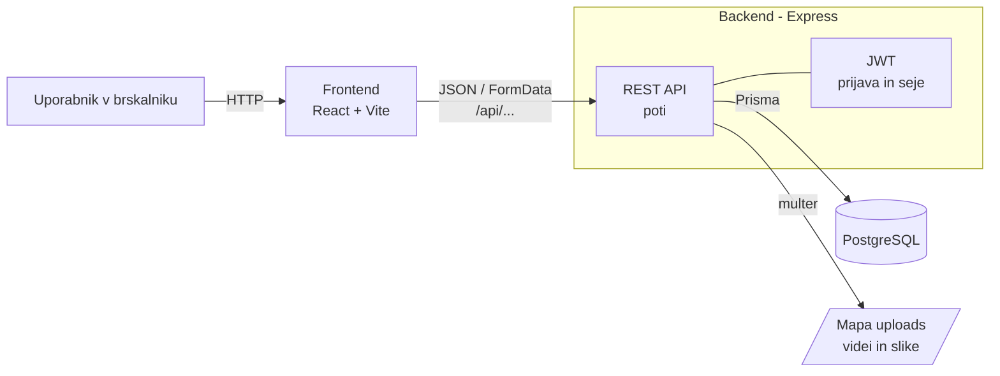

## ------- Arhitektura in tehnološki sklad -------

### 1. Arhitektura

#### Glavni deli sistema

- **Frontend** (mapa `frontend/`) – React aplikacija (Vite), ki teče v brskalniku. Vsebuje ločene poglede za podjetje, ustvarjalca in administratorja.
- **Backend** (mapa `backend/`) – Node.js strežnik z ogrodjem Express. Ponuja REST API, vsebuje poslovno logiko, preverja pravice in upravlja stanja questov.
- **Podatkovna baza** – PostgreSQL.
- **Hramba datotek** – mapa `backend/uploads` za videe in slike.

#### Komunikacija

- Frontend kliče backend prek HTTP zahtevkov na poti `/api/...` v formatu JSON.
- Med razvojem Vite strežnik zahtevke na `/api` posreduje (proxy) na backend, zato ni treba nastavljati CORS.
- Nalaganje videov in slik poteka z zahtevki `multipart/form-data`. Backend datoteko prebere s knjižnico **multer** in jo shrani v mapo `uploads`.
- Backend dostopa do baze prek **Prisme**.
- Datoteke iz mape `uploads` backend vrača prek API poti, pred tem preveri, ali ima uporabnik dostop.

#### Podatkovna baza

- **PostgreSQL**, nameščen lokalno na računalniku razvijalca.
- Prisma skrbi za shemo, migracije (ustvarjanje tabel) in poizvedbe.
- V bazi so samo podatki in poti do datotek, sami videi in slike so v mapi `uploads`.
- Stanje questa se ob vsakem branju preveri glede na rok: če je rok potekel, quest preide iz `open` v `judging`.

#### Avtentikacija in upravljanje uporabnikov

- Uporabnik se registrira z e-pošto in geslom ter izbere vlogo (podjetje ali ustvarjalec).
- Gesla so shranjena zgoščena z **bcrypt** (`bcryptjs`).
- Ob prijavi backend ustvari **JWT žeton** z `id` in vlogo uporabnika ter ga shrani v `httpOnly` piškotek.
- Pred vsako zaščiteno akcijo backend (middleware) preveri žeton, blokado in vlogo uporabnika.
- Administratorski račun se ustvari s seed skripto, registracija v vlogi administratorja ni mogoča.

#### Lokalni zagon

Predpogoja: nameščena Node.js in PostgreSQL.

Backend:

1. Kloniraj repozitorij, v mapi `backend` kopiraj `.env.example` v `.env` (povezava do baze in skrivni ključ za JWT).
2. Zaženi PostgreSQL in ustvari prazno bazo `getad`.
3. `cd backend` in `npm install` – namesti knjižnice.
4. `npx prisma migrate dev` – ustvari tabele v bazi.
5. `npx prisma db seed` – ustvari administratorski račun in testne podatke.
6. `npm run dev` – zažene backend na `http://localhost:3000`.

Frontend (v drugem terminalu):

1. `cd frontend` in `npm install`.
2. `npm run dev` – zažene frontend na `http://localhost:5173`.

#### Diagram

### 2. Tehnološki sklad

| Del | Tehnologija |
|---|---|
| Frontend | React, Vite, React Router, Tailwind CSS |
| Backend | Node.js, Express |
| Podatkovna baza | PostgreSQL, Prisma |
| Avtentikacija | JWT v `httpOnly` piškotku, bcrypt |
| Nalaganje datotek | multer, mapa `uploads` |
| Lokalni razvoj | Node.js, npm, lokalni PostgreSQL, Git |

#### Knjižnice

Frontend:

| Knjižnica | Namen |
|---|---|
| `react`, `react-dom` | uporabniški vmesnik |
| `vite` | razvojni strežnik in gradnja aplikacije |
| `react-router-dom` | usmerjanje med stranmi |
| `tailwindcss` | oblikovanje |

Backend:

| Knjižnica | Namen |
|---|---|
| `express` | strežnik in API poti |
| `prisma`, `@prisma/client` | shema baze, migracije in poizvedbe |
| `jsonwebtoken` | ustvarjanje in preverjanje JWT žetonov |
| `cookie-parser` | branje piškotkov |
| `bcryptjs` | kodiranje gesel |
| `multer` | nalaganje datotek |
| `dotenv` | branje nastavitev iz `.env` |

### 3. Arhitekturne odločitve

Podrobna utemeljitev vsake odločitve je v [ADR zapisih](adr/).

- **Ločen frontend in backend** – frontend (React + Vite) in backend (Express) sta v ločenih mapah, oba v JavaScriptu.
- **React** – razširjen in dobro dokumentiran, primeren za aplikacijo z več pogledi glede na vlogo.
- **PostgreSQL** – podatki so povezani (podjetja, questi, oddaje), zato je relacijska baza naravna izbira. PostgreSQL je zanesljiv, brezplačen in ga uporablja tudi Supabase, zato je kasnejša selitev v oblak preprosta.
- **Prisma** – tabele so opisane na enem mestu, migracije se ustvarijo samodejno, poizvedbe pa so pregledne in varne pred SQL injekcijami.
- **Prijava z JWT** – preprosta prijava z žetonom v `httpOnly` piškotku.
- **Datoteke v lokalni mapi** – za lokalni razvoj najenostavnejše, ob objavi v oblak se zamenjajo s Supabase Storage.
- **Preverjanje roka ob branju** – zapiranje questov deluje brez ločenega procesa, stanje pa je vedno pravilno, ko ga kdo pogleda.
- **Pripravljeno za oblak** – frontend se lahko kasneje objavi na AWS Amplify, backend na storitvi za Node.js (npr. Render), baza se preseli v Supabase, datoteke pa v Supabase Storage. Ker Supabase uporablja PostgreSQL, se zamenja samo povezava do baze v `.env`, koda aplikacije pa ostane enaka.
