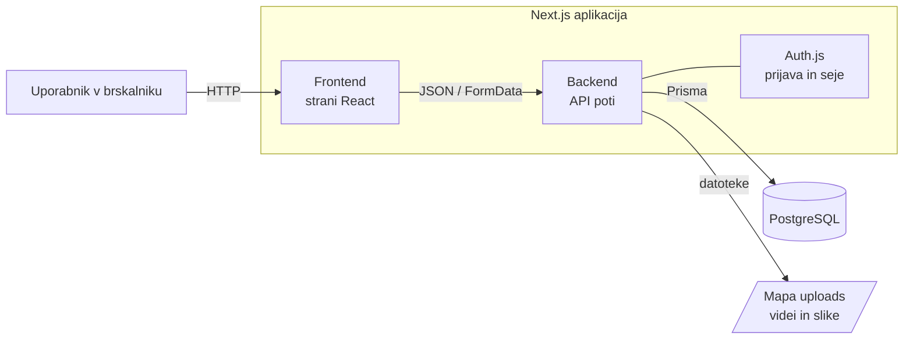

## ------- Arhitektura in tehnološki sklad -------

### 1. Arhitektura

#### Glavni deli sistema

- **Spletna aplikacija (Next.js)** – en projekt, ki vsebuje frontend in backend.
  - **Frontend** – strani v brskalniku z ločenimi pogledi za podjetje, ustvarjalca in administratorja.
  - **Backend** – API poti, ki vsebujejo poslovno logiko, preverjajo pravice in upravljajo stanja questov.
- **Podatkovna baza** – PostgreSQL.
- **Hramba datotek** – mapa `uploads` v projektu za videe in slike.

#### Komunikacija

- Frontend kliče backend prek HTTP zahtevkov na API poti (`/api/...`) v formatu JSON.
- Nalaganje videov in slik poteka z zahtevki `multipart/form-data`. Backend datoteko prebere z vgrajeno funkcijo `request.formData()` v Next.js in jo shrani v mapo `uploads`
- Backend dostopa do baze prek **Prisme**.
- Datoteke iz mape `uploads` backend vrača prek API poti, pred tem preveri, ali ima uporabnik dostop.

#### Podatkovna baza

- **PostgreSQL**, nameščen lokalno na računalniku razvijalca.
- Prisma skrbi za shemo, migracije (ustvarjanje tabel) in poizvedbe.
- V bazi so samo podatki in poti do datotek, sami videi in slike so v mapi `uploads`.
- Stanje questa se ob vsakem branju preveri glede na rok: če je rok potekel, quest preide iz `open` v `judging`.

#### Avtentikacija in upravljanje uporabnikov

- Uporabnik se registrira z e-pošto in geslom ter izbere vlogo (podjetje ali ustvarjalec).
- Gesla so shranjena zgoščena z **bcrypt**.
- Prijavo in seje upravlja **Auth.js**, seja je shranjena v šifriranem piškotku.
- Pred vsako zaščiteno akcijo backend preveri sejo in vlogo uporabnika.
- Administratorski račun se ustvari s seed skripto, registracija v vlogi administratorja ni mogoča.

#### Lokalni zagon

Predpogoja: nameščena Node.js in PostgreSQL.

1. Kloniraj repozitorij in kopiraj `.env.example` v `.env` (povezava do baze in skrivni ključ za Auth.js).
2. Zaženi PostgreSQL in ustvari prazno bazo `getad`.
3. `npm install` – namesti knjižnice.
4. `npx prisma migrate dev` – ustvari tabele v bazi.
5. `npx prisma db seed` – ustvari administratorski račun in testne podatke.
6. `npm run dev` – zažene aplikacijo na `http://localhost:3000`.

#### Diagram

### 2. Tehnološki sklad

| Del | Tehnologija |
|---|---|
| Frontend | Next.js (React), Tailwind CSS |
| Backend | Next.js API poti (Node.js) |
| Podatkovna baza | PostgreSQL, Prisma |
| Avtentikacija | Auth.js, bcrypt |
| Nalaganje datotek | vgrajena obdelava `FormData` v Next.js, mapa `uploads` |
| Lokalni razvoj | Node.js, npm, lokalni PostgreSQL, Git |

#### Knjižnice

| Knjižnica | Namen |
|---|---|
| `next`, `react`, `react-dom` | ogrodje aplikacije in uporabniški vmesnik |
| `tailwindcss` | oblikovanje |
| `prisma`, `@prisma/client` | shema baze, migracije in poizvedbe |
| `next-auth` (Auth.js) | prijava, odjava in seje |
| `bcryptjs` | kodiranje gesel |

### 3. Arhitekturne odločitve

- **En projekt v Next.js** – frontend in backend v isti kodi, en jezik (JavaScript), en ukaz za zagon.
- **React** – razširjen in dobro dokumentiran, primeren za aplikacijo z več pogledi glede na vlogo.
- **PostgreSQL** – podatki so povezani (podjetja, questi, oddaje), zato je relacijska baza naravna izbira. PostgreSQL je zanesljiv, brezplačen in ga uporablja tudi Supabase, zato je kasnejša selitev v oblak preprosta.
- **Prisma** – tabele so opisane na enem mestu, migracije se ustvarijo samodejno, poizvedbe pa so pregledne in varne pred SQL injekcijami.
- **Auth.js** – preverjena knjižnica za prijavo in seje
- **Datoteke v lokalni mapi** – za lokalni razvoj najenostavnejše, ob objavi v oblak se zamenjajo s Supabase Storage.
- **Preverjanje roka ob branju** – zapiranje questov deluje brez ločenega procesa, stanje pa je vedno pravilno, ko ga kdo pogleda.
- **Pripravljeno za oblak** – aplikacija se lahko kasneje objavi na AWS Amplify, baza preseli v Supabase, datoteke pa v Supabase Storage. Ker Supabase uporablja PostgreSQL, se zamenja samo povezava do baze v `.env`, koda aplikacije pa ostane enaka.
